# dnskit

**Find out why DNS isn't working, in plain English.**

dnskit is a command-line DNS troubleshooting toolkit. It tells you why a name doesn't
resolve, why a site won't load or email doesn't arrive, and whether the problem is your
computer, your network or the domain itself. Every result comes with an explanation and a
suggested fix, not just raw records.

- **One-command health check** with a score and a ranked list of fixes (`doctor`)
- **Lookups, reverse lookups and comparisons** across public resolvers and your own
- **Email checks**: MX, SPF (with the 10-lookup limit), DMARC and DKIM
- **Your computer's DNS setup**: dead or "ghost" DNS servers, hosts-file overrides, NXDOMAIN
  hijacking, intercepted DNS, broken IPv6, and the command to flush the cache
- **The full delegation chain** from the root servers (`trace`) and **DNSSEC** validation
- **Propagation** checks across 14 resolvers worldwide, and **watch** to see a change go live
- **For scripts**: `--json` on every command, `batch` for lists of domains, and a config file
- **VPN- and firewall-aware**: says so when DNS to outside servers is blocked, instead of
  just timing out

Works on Windows, macOS and Linux. Built on [dnspython](https://www.dnspython.org/),
[Typer](https://typer.tiangolo.com/) and [Rich](https://rich.readthedocs.io/).

📖 **[The dnskit User Guide](https://github.com/gladkhumalo/dnskit/blob/main/docs/USER_GUIDE.md)** covers every command and option, every
error message, and step-by-step recipes for common DNS problems.

## Contents

- [Installation](#installation)
- [Quick start](#quick-start)
- [How DNS works, in one trace](#how-dns-works-in-one-trace)
- [Commands](#commands)
- [JSON, batch, watch and config](#json-batch-watch-and-config)
- [Exit codes](#exit-codes)
- [Contributing](#contributing)
- [License](#license)

## Installation

dnskit needs **Python 3.11 or newer** (`python --version` to check).

**With pipx (recommended).** [pipx](https://pipx.pypa.io/) installs command-line tools in
their own environment and puts `dnskit` on your PATH, so it works from any terminal:

```bash
pipx install dnskit
dnskit --help
```

`pipx upgrade dnskit` moves to the newest release. For the latest code on `main` instead,
use `pipx install git+https://github.com/gladkhumalo/dnskit.git`.

**With pip, in a virtual environment:**

```bash
python -m venv .venv
.venv\Scripts\activate          # Windows
# source .venv/bin/activate     # macOS / Linux
pip install dnskit
dnskit --help
```

The `dnskit` command then works whenever the virtual environment is active. See the
[changelog](https://github.com/gladkhumalo/dnskit/blob/main/CHANGELOG.md) for what's in
each release.

## Quick start

The screenshots below are real runs against the reserved example domains, on a demo
computer whose DNS servers are 1.1.1.1 and 8.8.8.8
([scripts/readme_screenshots.py](https://github.com/gladkhumalo/dnskit/blob/main/scripts/readme_screenshots.py) regenerates them).

Not sure where a problem is? Start with `doctor`. It checks your computer's DNS setup and
the domain (records, the connection, email and DNSSEC) at the same time, and ranks what it
finds:

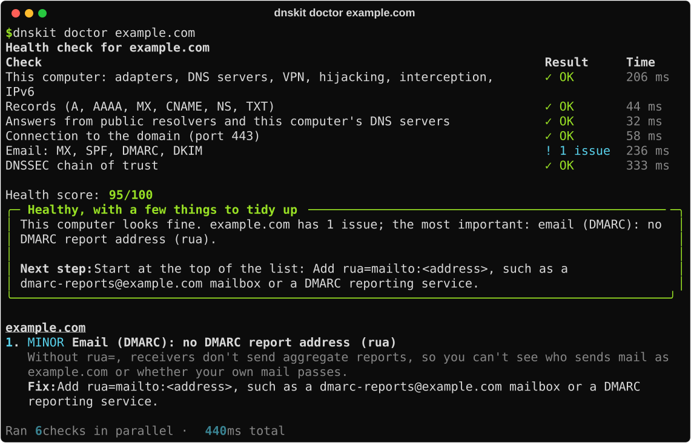

It separates problems with **this computer** from problems with **the domain**, and lists
notes (things worth knowing, with nothing to fix) separately. From there:

- `dnskit lookup example.com` to see the records themselves
- `dnskit reach example.com` when a site won't load: is it DNS or the connection?
- `dnskit local` when everything is slow or broken on one computer
- `dnskit <command> --help` for any command's options, examples and exit codes

## How DNS works, in one trace

Nobody has the whole DNS: it's a tree of servers, each responsible for one level of
names. To find `example.com`, a resolver (your DNS server, or 8.8.8.8) asks its way down
the tree. `dnskit trace` does exactly that, one step at a time, and shows each step:

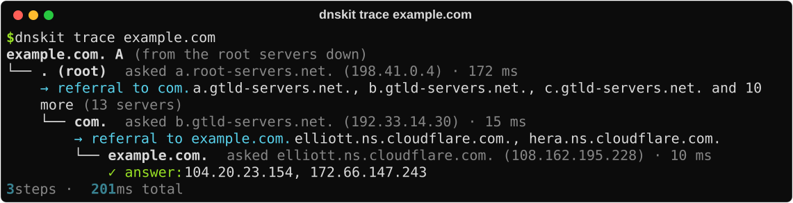

1. **The root servers** (`.`) don't know `example.com`, but they know who runs `com.`.
   They *refer* the question to the `com.` servers. There are 13 root server names,
   hard-coded into every resolver; that's where every lookup starts.
2. **The `com.` servers** don't know the address either, but they know which nameservers
   the domain's owner chose at the registrar: here `elliott` and `hera.ns.cloudflare.com`.
   This list is the domain's **delegation**.
3. **The domain's own nameservers** are *authoritative* for `example.com`: they hold its
   records and give the final answer.

A resolver then caches the answer for its **TTL** (time to live, in seconds), so the next
lookup skips the whole walk. That's also why a changed record takes a while to reach
everyone: resolvers keep serving the old answer until its TTL runs out.

When a domain fails for everyone, the trace shows which level breaks. For example, the
`com.` servers saying "no such domain" means it isn't registered (or expired). A
nameserver that doesn't answer means the DNS host is down. A *lame delegation* means the
registrar points at nameservers that don't serve the domain.

## Commands

| Command | What it answers |
|---|---|
| [`doctor`](#quick-start) | Is everything OK? A score and a ranked list of fixes. |
| [`lookup`](#lookup) | What records does this name have? |
| [`reverse`](#reverse) | Whose is this IP address? |
| [`compare`](#compare) | Do public resolvers and mine give the same answer? |
| [`email`](#email) | Is the domain's email set up right (MX, SPF, DMARC, DKIM)? |
| [`local`](#local) | Is this computer's DNS setup healthy? |
| [`resolvers`](#resolvers) | Which of my DNS servers answer, and how fast? |
| [`reach`](#reach) | A site won't load: is it DNS or the connection? |
| [`trace`](#how-dns-works-in-one-trace) | Where in the delegation does a domain break? |
| [`dnssec`](#dnssec) | Is DNSSEC on, and does it validate? |
| [`propagation`](#propagation) | Has my change reached resolvers worldwide? |
| [`batch`](#batch) | Check a whole list of domains. |
| [`watch`](#watch) | Tell me when the answer changes. |
| [`config`](#config) | My default settings and resolvers. |

### lookup

Looks up A, AAAA, MX, CNAME, NS and TXT at once, through the fastest of your DNS servers
(`--type` for one type, `--server` to ask a specific server):

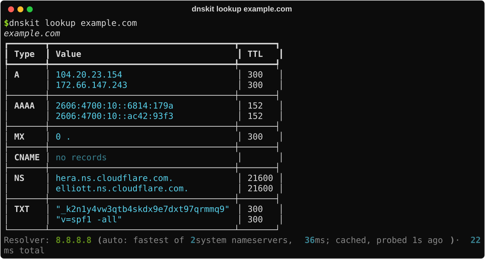

When a lookup fails, a panel says why ("Domain doesn't exist", "Query timed out", …) and
what to try next.

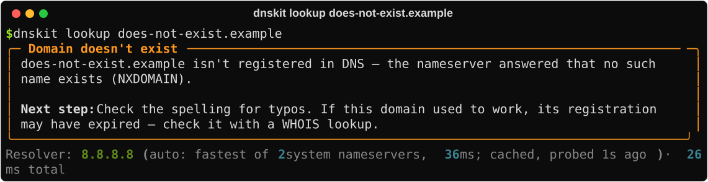

### reverse

Finds the hostname for an IPv4 or IPv6 address (its PTR record), for an unknown address in
a log or to check a mail server's reverse name:

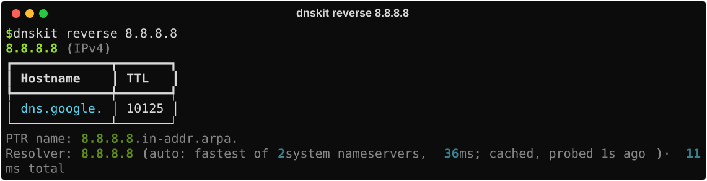

### compare

Asks Google, Cloudflare, Quad9 and each of your own DNS servers the same question, and
marks any that disagree. Useful when a site works on one network but not another:

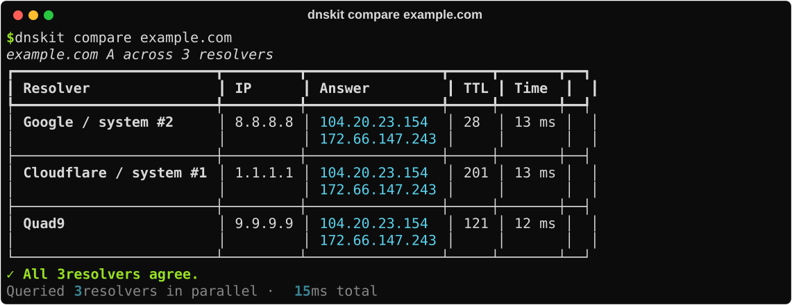

### email

Checks where mail is delivered (MX), who may send it (SPF), what receivers do with forged
mail (DMARC), and the signing keys (DKIM), each as pass, warn or fail with a fix:

<details>
<summary><code>$ dnskit email example.com</code></summary>

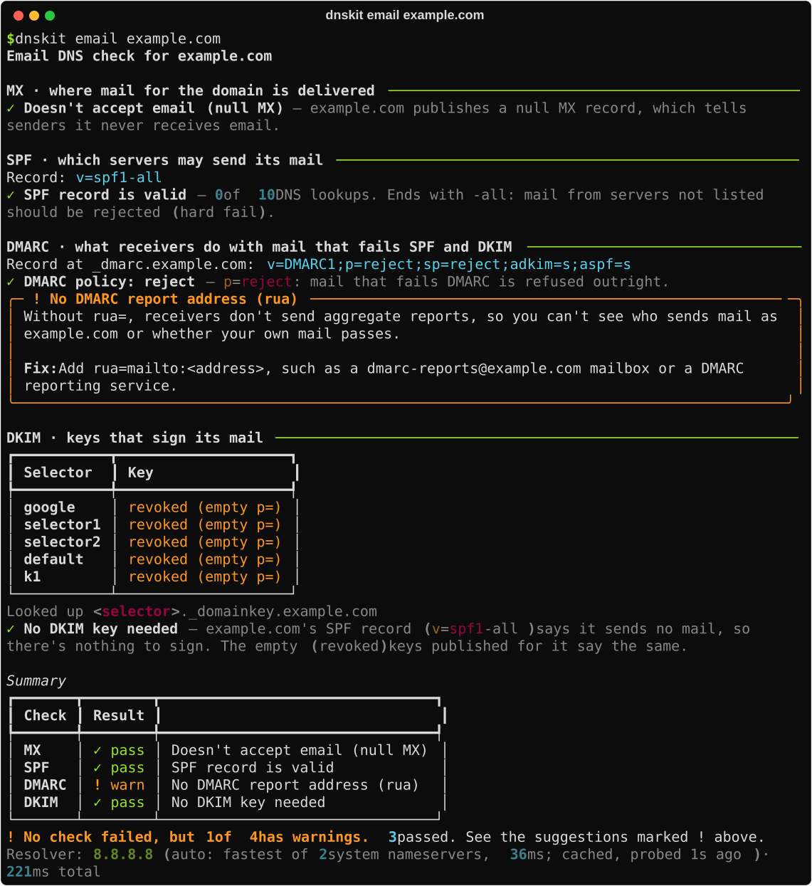

</details>

### local

Checks this computer: every network adapter and its DNS servers, servers that are dead,
slow or "ghosts" (left in the configuration by an old adapter or VPN), hosts-file entries
that override DNS, NXDOMAIN hijacking, interception by the network, and IPv6. It ends with
the problems found and the command to flush the DNS cache:

<details>
<summary><code>$ dnskit local</code></summary>

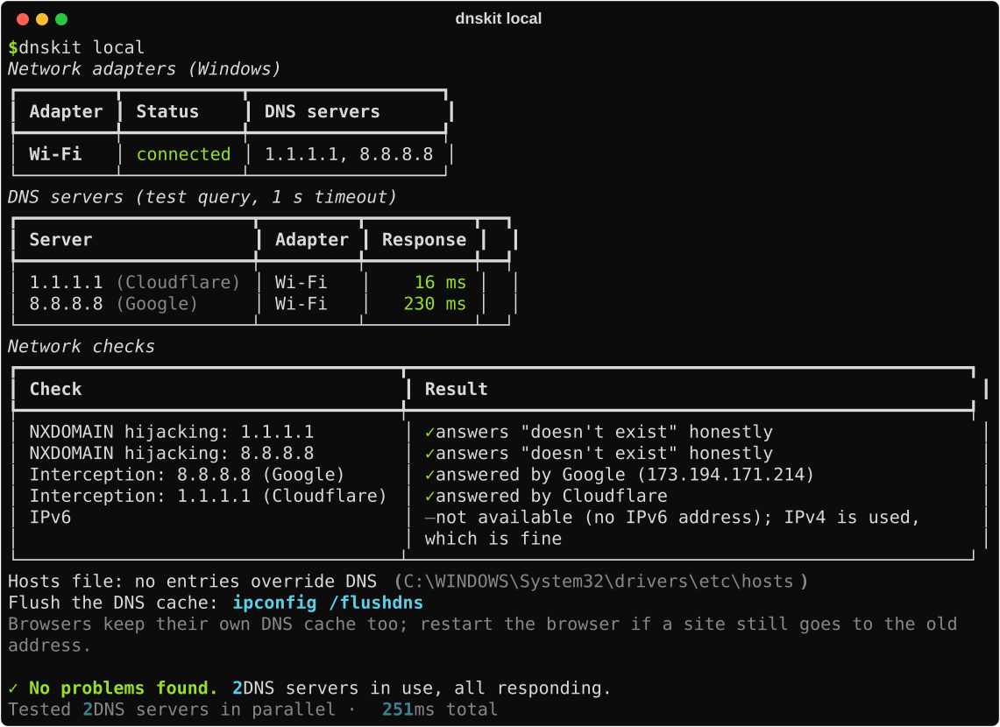

</details>

### resolvers

Tests each DNS server this computer uses and marks the one dnskit uses (the fastest). The
choice is remembered for 5 minutes, so commands don't each wait for a dead server:

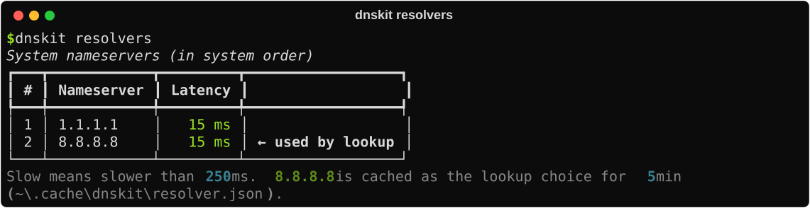

### reach

"The website won't load": looks the name up, connects to port 443 (or `--port`) on each
address, and says whether the problem is DNS, the connection, or neither:

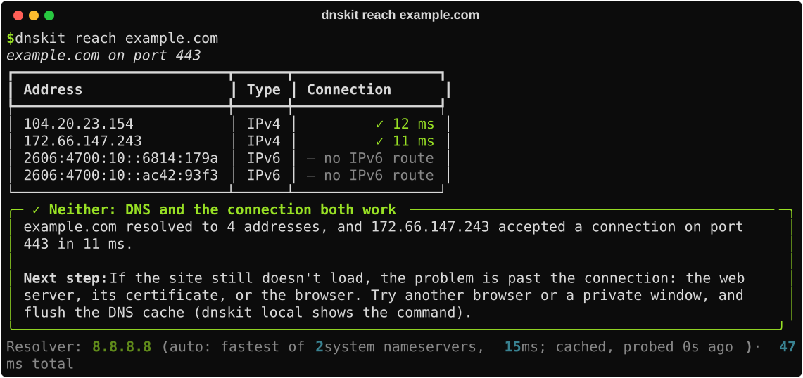

### dnssec

Checks every link of the DNSSEC chain of trust from the root down, verifies the signatures
itself, and warns when this computer's clock is wrong (which breaks validation):

<details>
<summary><code>$ dnskit dnssec example.com</code></summary>

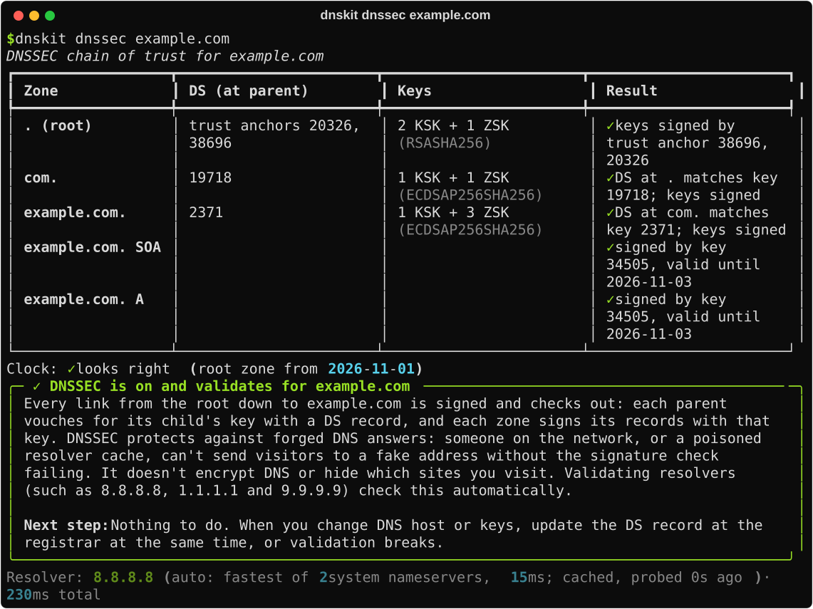

</details>

### propagation

After changing a record: asks 14 public resolvers (global anycast ones, plus ones in fixed
countries) and shows what share give the same answer. It tells a change still spreading
apart from a CDN's location-based answers:

<details>
<summary><code>$ dnskit propagation example.com</code></summary>

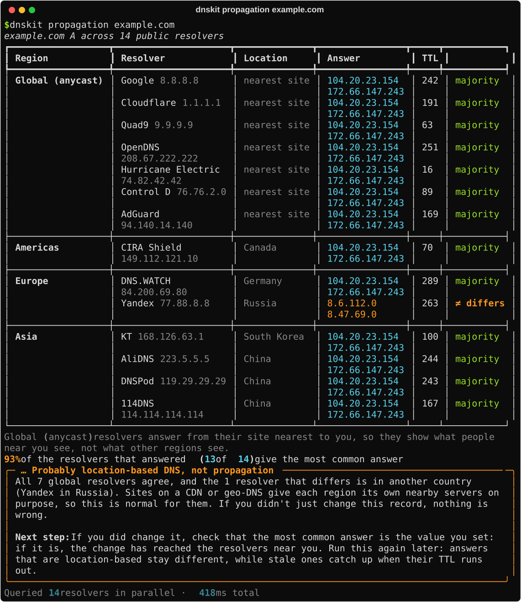

</details>

## JSON, batch, watch and config

### JSON

Every command takes `--json` and prints one JSON object instead of the report, with the
same exit code: `command`, `exit_code`, a short `summary`, the plain-English `diagnosis`,
and the full `report`. Timings are milliseconds, dates ISO 8601. For example, only the
summary and diagnosis of a `reach`:

```text
$ dnskit reach example.com --json   (summary and diagnosis only)
{
  "summary": {
    "verdict": "reachable"
  },
  "diagnosis": {
    "title": "Neither: DNS and the connection both work",
    "explanation": "example.com resolved to 4 addresses, and 104.20.23.154 accepted a connection on port 443 in 19 ms.",
    "suggestion": "If the site still doesn't load, the problem is past the connection: the web server, its certificate, or the browser. Try another browser or a private window, and flush the DNS cache (dnskit local shows the command)."
  }
}
```

```powershell
$result = dnskit doctor example.com --quick --json | ConvertFrom-Json
if ($result.summary.score -lt 90) { "example.com: $($result.diagnosis.title)" }
```

### batch

Runs `lookup`, `doctor` or `email` on every domain in a text file (one per line, `#`
comments allowed, `-` for standard input), a few at a time, and ends with a summary. For this `domains.txt`:

```text
# Our domains
example.com
example.org
https://www.example.net/
does-not-exist.example    # a typo
not a domain
```

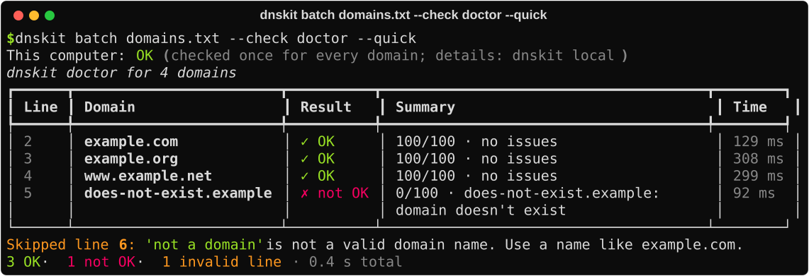

### watch

Re-checks a record every few seconds (30 by default) and beeps when the answer changes.
`--until` stops as soon as the new value is live. Answers that only rotate between
addresses already seen (a CDN) say "rotating (CDN)" instead of "CHANGED":

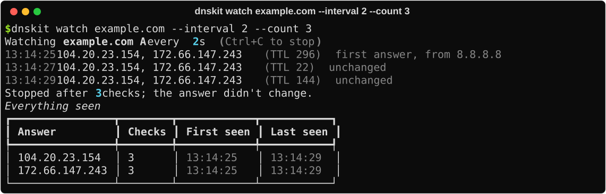

```bash
dnskit watch example.com --until 203.0.113.80 --interval 60
```

### config

An optional TOML file sets each command's defaults and can replace the resolvers that
`compare` and `propagation` ask. The command line always wins. `dnskit config --init`
creates a commented starter file, and `dnskit config` shows where it is and what it sets:

```toml
[defaults]
server = "1.1.1.1"      # ask this DNS server instead of choosing the fastest

[doctor]
quick = true

[compare]
resolvers = [
    { name = "Google", address = "8.8.8.8" },
    { name = "Office DNS", address = "10.0.0.53" },
]
```

The file is `%APPDATA%\dnskit\config.toml` on Windows and `~/.config/dnskit/config.toml`
elsewhere; set `DNSKIT_CONFIG` to use another.

## Exit codes

| Code | Meaning |
|---|---|
| `0` | Success: the name exists, the check passed, everything agrees. |
| `1` | A problem was found: the lookup failed, a check failed, resolvers disagree. |
| `2` | Invalid input: not a domain, an unknown record type, a broken config file. |
| `3` | `reach` only: DNS works but the connection doesn't. |
| `130` | `watch` only: stopped with Ctrl+C. |

Each command's `--help` lists its own exit codes, and the guide has
[the full list](https://github.com/gladkhumalo/dnskit/blob/main/docs/USER_GUIDE.md#10-using-dnskit-in-scripts).

## Contributing

Bug reports and pull requests are welcome. See [CONTRIBUTING.md](https://github.com/gladkhumalo/dnskit/blob/main/CONTRIBUTING.md) for
setting up a development environment, the architecture, and how changes are tested.

## License

dnskit is released under the [MIT License](https://github.com/gladkhumalo/dnskit/blob/main/LICENSE): you may use, change and share it,
including commercially, as long as the copyright notice comes along. It comes with no
warranty.
